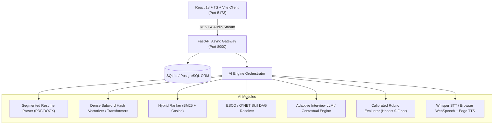

# SmartHire: AI-Powered Career Copilot

> Production-Quality AI Resume Analysis, Skill Gap Mapping, Job Matching & Bilingual Voice Mock Interview Platform.

SmartHire is a full-stack, enterprise-grade AI Career Copilot. It guides candidates through their complete career journey:
1. **Resume Parsing & Entity Extraction**: Segmented parsing of PDF/DOCX resumes extracting canonical tech skills, work experience, education, projects, and certifications without cross-contamination.
2. **Personalized Role Recommendations**: Matches candidate profiles against target industry roles using weighted semantic scoring.
3. **Live Job Aggregation & Ranking**: Live Google Jobs search via SerpAPI ranked with a hybrid scoring engine ($0.45 \cdot \text{BM25} + 0.55 \cdot \text{Cosine}$) with direct job-specific apply links.
4. **ESCO / O\*NET Skill Gap DAG**: Prerequisite graph resolution identifying skill gaps, prerequisite chains, and estimated study hours.
5. **Personalized Weekly Roadmap**: Interactive 6-week curriculum with database-persisted progress tracking.
6. **Bilingual Voice Mock Interviews**: Adaptive, turn-by-turn technical and behavioral voice interviews (English, Hindi, Hinglish) with live audio transcription, honest zero-floor calibrated grading, and downloadable official PDF diagnostic reports.

---

## 1. System Architecture



---

## 2. Technology Stack

- **Frontend**: React 18, TypeScript, Vite, Tailwind CSS, Lucide Icons, Custom SVG Radar Chart, Web Audio / MediaRecorder API, Axios
- **Backend API**: Python 3.11+, FastAPI (Async lifespan context), SQLAlchemy ORM 2.0, Pydantic v2 (ConfigDict, custom field validators), Bcrypt, PyJWT
- **NLP & AI Services**: 
  - Segmented resume parser with section boundaries (`SKILLS`, `EXPERIENCE`, `PROJECTS`, `EDUCATION`, `CERTIFICATIONS`)
  - Canonical 500+ tech skill taxonomy matching
  - Okapi BM25 keyword ranker + Cosine similarity vectorizer
  - ESCO / O\*NET prerequisite ontology DAG
  - Adaptive prompt interview generator with contextual follow-up logic
  - Calibrated evaluation rubric with non-answer detection (`"I don't know"` / `"no"` $\to 0\%$)
  - Bilingual & natural Hinglish romanized code-switching detection
  - Speech-to-Text: OpenAI Whisper API with browser WebSpeech live-transcript fallback
  - Text-to-Speech: Edge-TTS Neural Audio with browser SpeechSynthesis fallback
  - ReportLab PDF generator for official evaluation reports
- **Database**: Zero-config SQLite local fallback (`smarthire.db`) / PostgreSQL 15 for production
- **DevOps**: Docker, Docker Compose, Multi-stage Dockerfiles, Nginx reverse proxy

---

## 3. Project Structure

```
SmartHire/
├── backend/
│   ├── app/
│   │   ├── api/                     # REST API route endpoints
│   │   │   ├── auth.py              # Register, login, refresh, profile
│   │   │   ├── resume.py            # Upload, parse, profile fetch
│   │   │   ├── roles.py             # Role recommendations & matches
│   │   │   ├── jobs.py              # Live aggregated jobs & search
│   │   │   ├── skills.py            # Skill gap DAG & roadmap
│   │   │   ├── interview.py         # Mock interview sessions, voice & Q/A
│   │   │   ├── reports.py           # Evaluation reports & PDF export
│   │   │   └── metrics.py           # ML benchmark metrics
│   │   ├── core/                    # Config, logging, datetime utils (UTC)
│   │   ├── database/                # SQLAlchemy session, engine, seed data
│   │   ├── eval/                    # ML benchmark evaluation suite
│   │   ├── models/                  # SQLAlchemy 2.0 relational models (3NF)
│   │   ├── schemas/                 # Pydantic v2 request/response models
│   │   └── services/                # Business logic & AI abstractions
│   │       ├── ai/                  # Parser, embedder, matchers, evaluator
│   │       ├── auth/                # Security, password hashing & JWT
│   │       └── jobs/                # Job providers (SerpAPI Google Jobs & Fallback)
│   ├── sample_resumes/              # Pre-built test resumes (PDF + DOCX)
│   ├── tests/                       # Pytest automated test suite
│   ├── requirements.txt
│   ├── Dockerfile
│   └── main.py                      # FastAPI entrypoint & lifespan
├── frontend/
│   ├── src/
│   │   ├── api/                     # Axios client & typed endpoints
│   │   ├── auth/                    # AuthContext, ProtectedRoute, JWT storage
│   │   ├── components/              # RadarChart, AudioRecorder, DAG visualizer
│   │   ├── layouts/                 # AppLayout, AuthLayout, Sidebar
│   │   ├── pages/                   # Dashboard, Resume, Roles, Jobs, Interview, etc.
│   │   └── types/                   # TypeScript interfaces
│   ├── package.json
│   ├── Dockerfile
│   └── vite.config.ts
├── docs/
│   └── architecture.md              # In-depth architectural specification
├── scripts/
│   ├── run_local.ps1                # One-command Windows local runner
│   └── run_local.sh                 # One-command Unix/macOS runner
├── docker-compose.yml
├── .env.example
├── .gitignore
└── README.md
```

---

## 4. Zero-Key Development Mode vs Production APIs

SmartHire operates **100% out of the box** without requiring paid external API credentials:

| Feature | Zero-Key Dev Mode (Default) | With Production API Keys |
|---|---|---|
| **Live Job Search** | Curated tech jobs with direct search apply links | Live Google Jobs via SerpAPI |
| **Resume Embeddings** | Normalized subword semantic hash vectorizer | `sentence-transformers/all-MiniLM-L6-v2` |
| **Mock Interview LLM** | Contextual dynamic follow-up generator | Google Gemini API / OpenAI GPT-4o |
| **Interview Evaluation** | Grounded rubric with 0-floor non-answer detection | LLM-assisted multi-dimensional rubric |
| **Voice Speech-to-Text** | Browser Web Speech API live stream | OpenAI Whisper API |
| **Voice Text-to-Speech** | Browser SpeechSynthesis API | Neural Edge-TTS Streaming |
| **Database** | Zero-config local SQLite (`smarthire.db`) | PostgreSQL 15 (`DATABASE_URL=postgresql://...`) |

To configure production keys, copy `.env.example` to `.env`:
```bash
cp .env.example .env
cp .env.example backend/.env
```

---

## 5. Getting Started & Local Installation

### Prerequisites
- Python 3.11+
- Node.js 18+ & npm
- Git

### Quickstart (One Command)
On Windows:
```powershell
.\scripts\run_local.ps1
```
On Linux/macOS:
```bash
chmod +x scripts/run_local.sh
./scripts/run_local.sh
```

---

### Manual Step-by-Step Setup

#### 1. Backend Setup
```bash
cd backend
python -m pip install -r requirements.txt email-validator
# Copy environment configuration
cp ../.env.example .env
# Start FastAPI backend
python -m uvicorn main:app --host 127.0.0.1 --port 8000 --reload
```
The backend starts at `http://localhost:8000`. Interactive OpenAPI documentation is accessible at `http://localhost:8000/docs`.

#### 2. Frontend Setup
```bash
cd frontend
npm install
npm run dev
```
The React application starts at `http://localhost:5173`.

---

## 6. Running with Docker Compose

To launch the full production environment (PostgreSQL + FastAPI + React SPA on Nginx):
```bash
docker-compose up --build
```
- Frontend: `http://localhost:3000`
- Backend API: `http://localhost:8000/api`
- Swagger Docs: `http://localhost:8000/docs`
- PostgreSQL: `localhost:5432`

---

## 7. Automated Testing

Run the full pytest backend test suite:
```bash
cd backend
python -m pytest tests/test_backend.py -v
```

All 6 test suites verify:
- API health and database connectivity
- User authentication, bcrypt password hashing, and JWT token issuance
- Resume text extraction and canonical skill entity parsing
- Hybrid BM25 Okapi + Cosine similarity job ranking
- Bilingual Hinglish code-switching detection
- Adaptive dynamic question generation

To verify the frontend TypeScript and production build:
```bash
cd frontend
npm run build
```

---

## 8. End-to-End Application Walkthrough

1. **Authentication**: Register or log in at `/login`. Passwords are encrypted with bcrypt, and sessions use stateless JWT tokens.
2. **Resume Upload**: At `/resume`, upload any standard PDF or DOCX file. The parser cleanly separates Skills, Projects, Experience, and Education without data contamination.
3. **Role Matching**: Visit `/roles` to review matched career tracks scored against your extracted skills.
4. **Skill Gap DAG**: Click **Analyze Skill Gap** to visualize your skill radar chart, prerequisite DAG linkages, and estimated study hours.
5. **Learning Roadmap**: Open `/roadmap` to track your 6-week curriculum with database-persisted task statuses.
6. **Live Jobs**: Navigate to `/jobs` to view live openings ranked by hybrid BM25 + Cosine similarity with direct apply links to job postings.
7. **Mock Interview**: Start a voice interview at `/interview`. Choose English, Hindi, or Hinglish. Receive turn-by-turn adaptive follow-up questions, live audio speech-to-text, and calibrated grading across Technical Accuracy, Communication, and Concept Coverage.
8. **Diagnostic Report**: Conclude the interview to generate an executive diagnostic report with full Q&A breakdown and download an official PDF copy.

---

## 9. License

This project is licensed under the MIT License.
