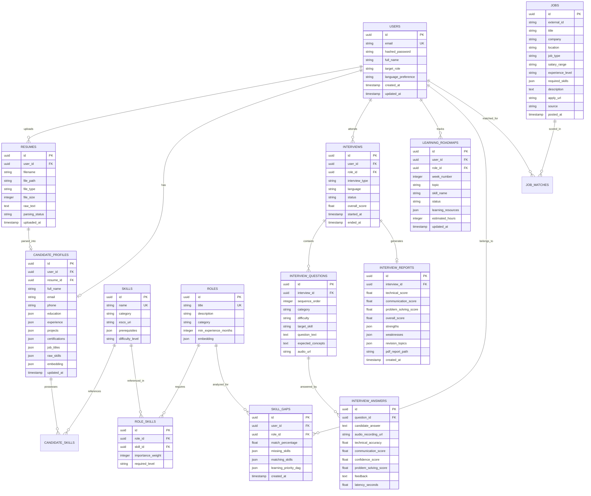

# SmartHire — System Architecture & Technical Specification

## 1. Architectural Overview

SmartHire is an enterprise-grade AI Career Copilot built with a modular, service-oriented monolithic architecture. It decouples high-throughput API handling, relational persistence, and hybrid AI/NLP analytical services while retaining single-command local development simplicity.

```mermaid
flowchart TD
    subgraph Client Layer ["Client Layer (React 18 + TS + Tailwind)"]
        UI[Single Page App UI]
        AudioRec[Web Audio / MediaRecorder API]
        Charts[Radar / Roadmap / Metric Visualizers]
    end

    subgraph API Layer ["API Gateway / Routing (FastAPI Async)"]
        Router[FastAPI Application Router]
        AuthMid[JWT Authentication Middleware]
        CORS[CORS & Security Middleware]
        ErrHandler[Structured Error & Logging Handler]
    end

    subgraph Core Services ["Domain & Orchestration Services"]
        AuthSvc[Auth Service (Bcrypt + JWT)]
        ResumeSvc[Resume Processing Pipeline]
        RoleSvc[Role Recommendation Service]
        JobSvc[Job Search Aggregator Layer]
        SkillSvc[Skill Gap & Taxonomy Engine]
        InterviewSvc[Mock Interview Orchestrator]
        ReportSvc[PDF & Metric Report Generator]
    end

    subgraph AI Engines ["AI & NLP Intelligence Layer"]
        Extractor[NLP/Regex Section & Entity Extractor]
        EmbedEngine[Sentence-Transformers all-MiniLM-L6-v2]
        HybridRanker[BM25 + Cosine Similarity Hybrid Matcher]
        OntologyDAG[ESCO / O*NET Prerequisite Graph]
        LLMDriver[Structured LLM Question & Feedback Engine]
        VoiceBridge[Whisper STT + Edge-TTS Bilingual Audio Bridge]
    end

    subgraph Storage Layer ["Persistence & Cache"]
        DB[(PostgreSQL / SQLite Storage Engine)]
        Filesystem[(Encrypted Resume & Audio Artifact Store)]
        MemoryCache[In-Memory / Redis LRU Cache]
    end

    subgraph External Providers ["External Job & AI Providers"]
        SerpAPI[SerpAPI / Google Jobs]
        OpenAI[OpenAI / Gemini API]
        MockFallbacks[Mock Providers for Zero-Key Dev]
    end

    UI --> Router
    AudioRec --> Router
    Router --> AuthMid --> CORS
    CORS --> AuthSvc & ResumeSvc & RoleSvc & JobSvc & SkillSvc & InterviewSvc & ReportSvc
    
    ResumeSvc --> Extractor --> EmbedEngine
    RoleSvc --> EmbedEngine
    JobSvc --> HybridRanker
    JobSvc --> SerpAPI & MockFallbacks
    SkillSvc --> OntologyDAG
    InterviewSvc --> LLMDriver & VoiceBridge
    LLMDriver --> OpenAI & MockFallbacks
    VoiceBridge --> OpenAI & MockFallbacks

    CoreServices --> DB
    CoreServices --> Filesystem
    CoreServices --> MemoryCache
```

---

## 2. Directory Structure

```
smarthire/
├── backend/
│   ├── app/
│   │   ├── api/                     # REST API route endpoints
│   │   │   ├── auth.py              # Register, login, refresh, profile
│   │   │   ├── resume.py            # Upload, parse, profile fetch
│   │   │   ├── roles.py             # Role recommendations & matches
│   │   │   ├── jobs.py              # Aggregated live jobs & search
│   │   │   ├── skills.py            # Skill gap analysis & roadmap
│   │   │   ├── interview.py         # Mock interview sessions & questions
│   │   │   ├── reports.py           # Evaluation reports & PDF export
│   │   │   └── metrics.py           # ML metrics (F1, Precision, NDCG@10, WER)
│   │   ├── core/                    # Core configuration and logging
│   │   │   ├── config.py            # Pydantic BaseSettings
│   │   │   └── logging.py           # Structured JSON logger
│   │   ├── database/                # Relational database layer
│   │   │   ├── base.py              # DeclarativeBase
│   │   │   ├── session.py           # SessionLocal & Engine factory
│   │   │   └── seed_data.py         # 12 Roles, 65+ Skills, Sample Resumes
│   │   ├── models/                  # SQLAlchemy Relational Models
│   │   │   ├── user.py
│   │   │   ├── resume.py
│   │   │   ├── candidate_profile.py
│   │   │   ├── skill.py
│   │   │   ├── role.py
│   │   │   ├── job.py
│   │   │   ├── skill_gap.py
│   │   │   └── interview.py
│   │   ├── schemas/                 # Pydantic Request/Response models
│   │   │   ├── auth.py
│   │   │   ├── resume.py
│   │   │   ├── role.py
│   │   │   ├── job.py
│   │   │   ├── skill.py
│   │   │   ├── interview.py
│   │   │   └── report.py
│   │   └── services/                # Business logic & AI abstractions
│   │       ├── auth/
│   │       ├── ai/
│   │       │   ├── resume_parser.py # PDF/DOCX multi-section parser
│   │       │   ├── embeddings.py    # Vector encoder with graceful fallback
│   │       │   ├── role_matcher.py  # Profile-to-Role semantic similarity
│   │       │   ├── job_matcher.py   # BM25 + Cosine hybrid ranking engine
│   │       │   ├── skill_gap_engine.py # ESCO/O*NET DAG & Topological Sort
│   │       │   ├── question_generator.py # Dynamic LLM question prompt
│   │       │   ├── interview_evaluator.py # Bilingual multi-metric evaluation
│   │       │   ├── speech_to_text.py # Whisper / Browser STT adapter
│   │       │   ├── text_to_speech.py # Edge-TTS / WebSpeech adapter
│   │       │   └── report_generator.py # PDF generation engine
│   │       └── jobs/
│   │           ├── providers/       # JobProvider abstraction
│   │           │   ├── base.py
│   │           │   ├── google_jobs.py
│   │           │   ├── linkedin.py
│   │           │   └── fallback.py
│   │           └── service.py
│   ├── eval/                        # ML Evaluation suite
│   │   └── eval_ml.py               # F1, NDCG@10, WER, Latency benchmark
│   ├── sample_resumes/              # 5 pre-built real resumes for testing
│   ├── tests/                       # Pytest automated test suite
│   ├── requirements.txt
│   └── main.py                      # FastAPI entrypoint
├── frontend/
│   ├── src/
│   │   ├── api/                     # Axios client & typed endpoints
│   │   ├── auth/                    # AuthContext, ProtectedRoute, tokens
│   │   ├── components/              # Shared UI components (Modals, Nav, Badges)
│   │   ├── layouts/                 # AppLayout, AuthLayout
│   │   ├── pages/                   # Full application pages
│   │   │   ├── Login.tsx
│   │   │   ├── Register.tsx
│   │   │   ├── Dashboard.tsx
│   │   │   ├── ResumeUpload.tsx
│   │   │   ├── RoleRecommendations.tsx
│   │   │   ├── JobsDirectory.tsx
│   │   │   ├── SkillGapAnalysis.tsx
│   │   │   ├── LearningRoadmap.tsx
│   │   │   ├── MockInterview.tsx
│   │   │   ├── InterviewHistory.tsx
│   │   │   ├── InterviewReportView.tsx
│   │   │   ├── Profile.tsx
│   │   │   └── MLEvaluation.tsx
│   │   ├── types/                   # TypeScript interfaces
│   │   ├── utils/                   # Helpers, Audio Recorder, Formatters
│   │   ├── App.tsx
│   │   └── main.tsx
│   ├── package.json
│   ├── tailwind.config.js
│   ├── tsconfig.json
│   └── vite.config.ts
├── database/                        # Database scripts & migrations
├── docs/                            # In-depth architectural & API docs
├── scripts/                         # CLI execution & seed helpers
├── docker-compose.yml
├── .env.example
└── README.md
```

---

## 3. Relational Database Schema

The database design uses third normal form (3NF) for relational integrity while storing high-dimensional vector representations and nested unstructured details as JSON/array attributes.



---

## 4. REST API Specification

### Authentication (`/api/auth`)
- `POST /api/auth/register`: Create user account (`email`, `password`, `full_name`) -> returns `{ user, access_token }`
- `POST /api/auth/login`: Authenticate credentials -> returns `{ user, access_token }`
- `GET /api/auth/me`: Current authenticated user profile
- `PUT /api/auth/profile`: Update career preferences and language setting

### Resume Operations (`/api/resume`)
- `POST /api/resume/upload`: Multipart upload (PDF/DOCX) -> Validates, extracts text, triggers async parsing
- `GET /api/resume/status/{resume_id}`: Poll parsing pipeline status
- `GET /api/resume/profile`: Get structured candidate profile JSON
- `GET /api/resume/download/{resume_id}`: Download original uploaded resume

### Role Recommendation (`/api/roles`)
- `GET /api/roles/recommendations`: Compute semantic cosine similarity between candidate profile embedding and seeded role ontology embeddings. Returns Top matching roles with breakdown of matched & gap skills.
- `GET /api/roles/{role_id}`: Detailed role specifications, required skills & benchmarks

### Job Matching Engine (`/api/jobs`)
- `GET /api/jobs/recommendations`: Search live jobs via JobProvider with Hybrid BM25 + Vector ranking:
  $$\text{FinalScore} = w_{\text{BM25}} \cdot \text{Score}_{\text{BM25}} + w_{\text{Cosine}} \cdot \text{Score}_{\text{Cosine}}$$
- `POST /api/jobs/search`: Filter by role, location, remote, minimum salary

### Skill Gap Analysis & Roadmap (`/api/skills`)
- `POST /api/skills/analyze`: Target role vs candidate profile comparison -> Computes ESCO/O*NET skill gap DAG, priority scores, and prerequisite dependencies.
- `GET /api/skills/roadmap`: Weekly personalized learning plan with topological prerequisite ordering
- `PATCH /api/skills/roadmap/{item_id}`: Update skill completion status (`not_started`, `in_progress`, `completed`)

### AI Mock Interview (`/api/interview`)
- `POST /api/interview/start`: Initialize dynamic interview for target role and candidate skill gaps (`role_id`, `language`: English, Hindi, Hinglish)
- `POST /api/interview/{id}/answer`: Submit candidate answer (text or transcript) -> triggers LLM multi-dimensional evaluation and dynamic follow-up question generation
- `POST /api/interview/{id}/voice`: Multipart audio upload -> Whisper STT transcript -> LLM evaluation -> Edge-TTS synthesized speech return
- `POST /api/interview/{id}/complete`: Finalize interview session and trigger report generator
- `GET /api/interview/{id}/report`: Detailed evaluation report with radar scores, strengths, weaknesses & PDF link
- `GET /api/interview/history`: Historical sessions with scores over time

### Evaluation & Observability (`/api/metrics`)
- `GET /api/metrics/ml`: Returns live benchmark metrics (F1, Precision, NDCG@10, WER, Latency targets vs actuals)

---

## 5. AI Service Pipelines

### 5.1 Resume Extraction Pipeline
1. **Document Parsing**: Ingestion via PyMuPDF (`fitz`) or `python-docx` to extract structured text buffers.
2. **Section Segmentation**: Regex heuristics and NLP boundary detection identify headings: Summary, Experience, Education, Skills, Projects, Certifications.
3. **Skill Entity Recognition**: Exact and fuzzy dictionary matching cross-referenced against 500+ tech canonical skills, plus spaCy noun-chunk extraction.
4. **Vector Embedding**: Dense 384-dimensional sentence embedding generated with `sentence-transformers/all-MiniLM-L6-v2`.

### 5.2 Hybrid Job Matching Architecture
- **Keyword Match (BM25)**: Scores frequency of required hard skills and job title tokens.
- **Semantic Match (Cosine Similarity)**: Measures semantic proximity between candidate profile text and job descriptions.
- **Configurable Weights**: Defaults to $0.45 \times \text{BM25} + 0.55 \times \text{Cosine}$.

### 5.3 ESCO/O*NET Skill Gap Graph Engine
- Builds a Directed Acyclic Graph (DAG) of technical competencies where edges represent prerequisite relationships (e.g., `DSA` $\to$ `System Design` $\to$ `Backend Architecture`).
- Uses Topological Sorting to construct the multi-week step-by-step roadmap.

### 5.4 Bilingual & Hinglish Mock Interview Pipeline
- **Prompt Engineering**: The interviewer persona dynamically adapts to English, Hindi, or Hinglish (code-switching).
- **Follow-up Logic**:
  - High accuracy answer ($\ge 75\%$) $\to$ Dig deeper with architectural scaling / edge cases.
  - Low accuracy answer ($< 50\%$) $\to$ Offer a gentle clarifying prompt to test core principles.
- **Evaluation Dimensions**:
  1. Technical Accuracy (0-100%)
  2. Communication & Articulation (0-100%)
  3. Problem Solving & Reasoning (0-100%)
  4. Confidence & Structure (0-100%)
- **Audio Pipeline**:
  - Client MediaRecorder captures WebM/WAV audio $\to$ Backend Whisper STT transcription $\to$ LLM evaluation $\to$ Edge-TTS / WebSpeech audio stream response. Latency is logged per turn.

---

## 6. External Providers & Zero-Key Fallback

| Capability | Production Provider | Fallback / Zero-Key Dev Mode |
|---|---|---|
| Job Listings | SerpAPI (Google Jobs) | `FallbackJobProvider` with 15 live-structure curated tech jobs |
| LLM Reasoning | OpenAI GPT-4o-mini / Gemini | `LocalLLMProvider` with dynamic heuristic template engine |
| Text Embedding | SentenceTransformers (`all-MiniLM-L6-v2`) | Built-in TF-IDF / Normalized Token Hash Vectorizer |
| Speech-to-Text | OpenAI Whisper | Local PyTorch Whisper or Web Speech API Browser STT |
| Text-to-Speech | Edge-TTS Async | Browser SpeechSynthesis API Fallback |
| Database | PostgreSQL 15+ | Zero-config SQLite engine (`smarthire.db`) |
